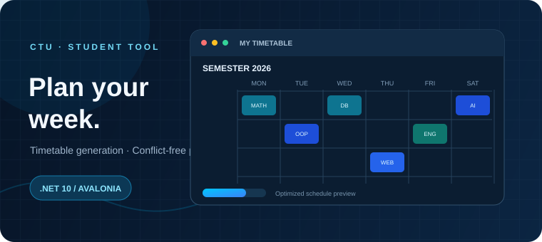
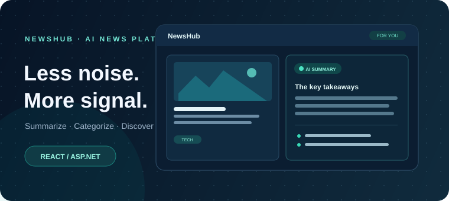
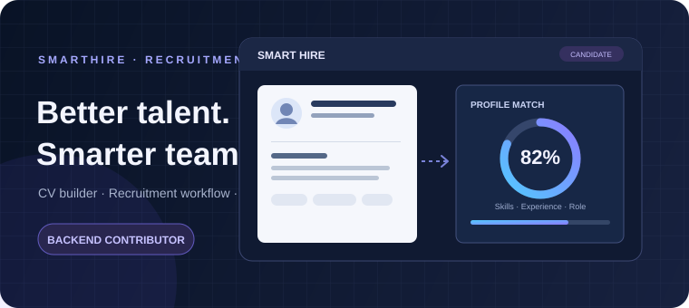

  

  

  
📞 0923521277 &nbsp;|&nbsp;📍 Ninh Kieu, Can Tho, Vietnam &nbsp;|&nbsp; ✉️ <a href="mailto:trantrongphuc1501@gmail.com">trantrongphuc1501@gmail.com</a>  
 
👤Portfolio: https://phuctran1501-profile.vercel.app/ 

  

## About Me

I'm Phúc, a Software Engineer student and aspiring Backend / Fullstack Developer based in Can Tho, Vietnam.

I enjoy building practical, efficient, and maintainable web applications. My current focus is on developing strong backend foundations with **C# and ASP.NET**, while expanding my frontend skills with **React and TypeScript**.

I'm also interested in how modern software development workflows are evolving in the age of AI — from writing clean code and designing reliable systems to collaborating, reviewing code, and shipping real-world products.

* Based in Can Tho, Vietnam
* Currently learning C# / ASP.NET and React
* Interested in backend architecture, databases, and fullstack development
* Exploring practical AI-assisted development workflows
* Always learning, building, and improving

  

## Tech Stack

| Category | Icons | Technologies |
|:---|:---:|:---|
| **Backend** |  | C#, .NET 10, NodeJS, Express.js |
| **Frontend & UI** |   | TypeScript, React, HTML5, CSS3, Tailwind CSS, Bootstrap |
| **Database & Backend Services** |  | MongoDB, PostgreSQL, Supabase, Firebase, Redis |
| **API Documentation & Testing** |   | Swagger, OpenAPI, Postman |
| **Tools & Workflow** |  | Docker, Git, GitHub, Visual Studio Code, Electron |

  

<h2 align="center">Selected Projects</h2><table>
  <tr>
    <td width="33%" valign="top">
      
      <h3>CTU-Scheduler</h3>
      DESKTOP APP · RESEARCH PROJECT
      
Automated timetable planning for CTU students.

      C# · .NET 10 · Avalonia UI 
      <a href="https://github.com/d3nhatv0lam/CTU-Scheduler">↗ Repository</a>
    </td>
    <td width="33%" valign="top">
      
      <h3>NewsHub</h3>
      FULLSTACK · AI-POWERED
      
AI-powered news curation, summaries and semantic discovery.

      React · TypeScript · .NET 10 · PostgreSQL · Docker 
      <a href="https://github.com/phuctran1501/NewsHub">↗ Repository</a>
    </td>
    <td width="33%" valign="top">
      
      <h3>SmartHire</h3>
      TEAM PROJECT · IN DEVELOPMENT
      
Recruitment platform with CV building and AI-assisted workflows.

      React · TypeScript · .NET 10 · PostgreSQL · Docker 
      <a href="https://github.com/SE-Project-CTU/smart-recruitment-app">↗ Repository</a>
    </td>
  </tr>
</table>

  

### 🌐 Connect With Me

  <i>Build practical things. Learn continuously. Grow as a developer.</i>

  

<h2 align="center">GitHub Statistics</h2>

  
  

